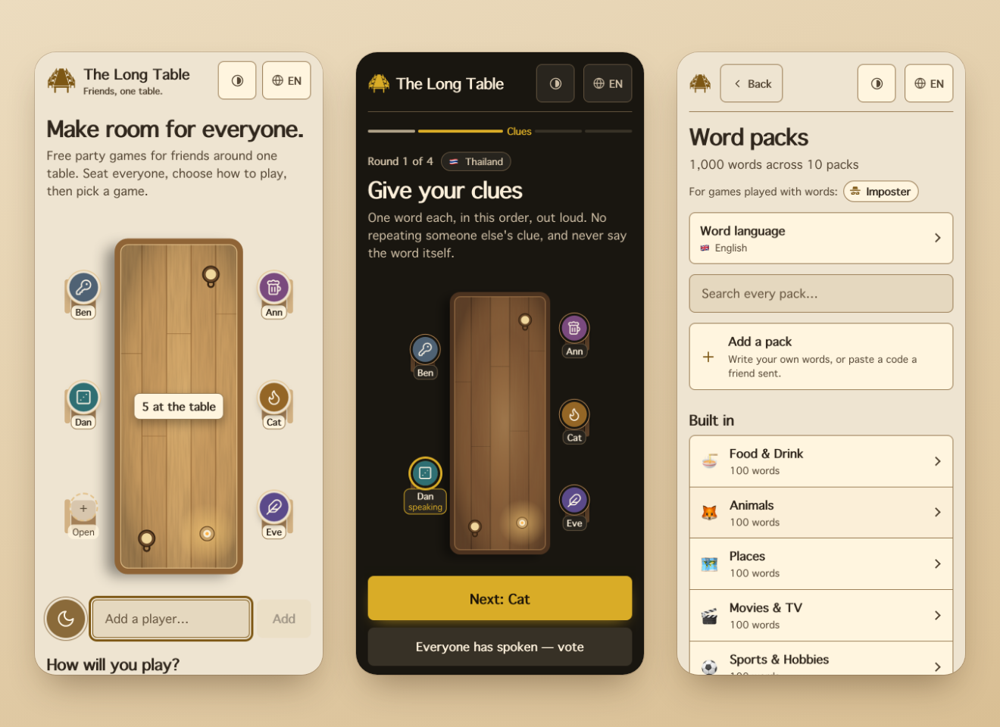

# The Long Table

[](https://unknown-x0.github.io/The-Long-Table/)
[](https://github.com/UNKNOWN-X0/The-Long-Table/actions/workflows/ci.yml)
[](package.json)
[](package.json)
[](LICENSE)

Free, highly customisable party games for friends around one table, on one phone passed around or everyone's own. It starts with Imposter, a game of secret words and bluffing, in English, Thai and German.

**[Play The Long Table →](https://unknown-x0.github.io/The-Long-Table/)** · [Changelog](CHANGELOG.md) · [Playtest guide](PLAYTEST.md) · [Report a bug](https://github.com/UNKNOWN-X0/The-Long-Table/issues)



## Features

- **Free:** no account, no ads, no tracking and nothing to buy. Open source: the code is MIT and the built-in word packs are CC BY-NC-SA 4.0.
- **Highly customisable:** your own word packs (typed, pasted, written with any AI chat, or loaded from a friend's share code), four presets or every rule by hand, optional roles, scoring, a clue timer, an emblem for every player, five wood themes in light or dark.
- **A community library:** share a pack with everyone through a short GitHub form; once it has been read it appears under **From the community** in every table's pack library, one tap from **Add to my packs**.
- **One table for every game:** the group sits down once at the hub, each with a name and an emblem, and every game starts with the people already seated.
- **Two ways to play:** pass one phone around the table, or everyone on their own phone in a room joined by a code or a link.
- **Imposter, the first game:** everyone but the imposters gets the same secret word; one-word clues, a vote, and a last guess for the imposter. Ten built-in packs per language.
- **Three languages:** English, Thai and German, with the interface language and the word language chosen separately.
- **Fair by design:** your card shows only while you hold it, and a room's server never sends a phone a word or role it should not hold.
- **Made for a table:** the button you need next stays under your thumb, every step opens at its top, the verdict gets a moment of suspense, and sound effects (off until you turn them on) mark the deal, the card, the vote and the win.
- **Picks up where you left off:** saved one-phone rounds, room reconnection, players shown as away, and the host role handed on when the host leaves.

## Getting started

### Use it online

**[Play in your browser](https://unknown-x0.github.io/The-Long-Table/)** for pass-and-play on one phone. Rooms need the Node server (below, or [Deploying](#deploying)).

### Run it yourself

Install **Node.js 22 or newer**, then:

```sh
git clone https://github.com/UNKNOWN-X0/The-Long-Table.git
cd The-Long-Table
npm install
npm run dev        # http://localhost:5174, one-phone mode, hot reload
```

For phone-to-phone play, `npm run party` builds the site and serves it on your wifi, printing the address everyone else types into their phone. When you are working on the interface *and* want rooms, run `npm run serve` (the party server on 5173) in one terminal and `npm run dev` in another; Vite proxies `/api` to the server, so it behaves as in production.

**Without a terminal:** double-click `Play Imposter.command` (Mac; right-click and choose Open the first time) or `Play Imposter.bat` (Windows). It installs what is missing, builds, starts the server, and opens the browser.

## Usage

### Ways to play

| Mode | How it works | What you need |
| --- | --- | --- |
| One phone | Seat everyone at the hub, choose **Play on one phone**, pick a game, then pass the phone; each player holds their card to see it, and it covers again when they let go. | A browser. Use the link above. |
| Room | The host chooses **Play in a room** and picks a game; everyone else joins on their own phone with the code (**Have a code?**) or the link the host shares. | The Node server, on the same wifi or publicly hosted ([Deploying](#deploying)). |

New to it? **How it works**, at the foot of the hub, explains the table; each game's card has its own **How to play**.

### Making it yours

Everything here is a setting or a pack, with no code:

- **Word packs:** open the pack library from the hub. Write a pack by typing or pasting one entry per line (`word, near miss`), or use **Write it with AI** to copy a ready prompt into any AI chat and paste its answer back. The editor reports every line it could not use, quoting it. **Send this to anybody** turns a pack into a code a friend can load, and **Share it with everyone** sends it to the community library: a reviewed pack appears under **From the community** in every table's pack library, with **Add to my packs**.
- **Rules:** pick **Standard**, **Quick**, **Careful** or **Chaos**, then change anything in the list below them: each setting is one row saying what it is set to, and tapping it opens its choices. How many imposters, what they see, whether they know, rounds, the time per speaker, calling the word, the last guess, roles and scoring. Change any of them and **Your own rules** says which preset you started from.
- **The table:** each player picks one of twelve emblems; the host can tap a seat to remove someone.
- **Looks, sound and language:** the **Settings** button (⚙) holds Display (light or dark, and five woods: Birch, Oak, Teak, Mahogany, Walnut), Sound, and Language (English, Thai or German). Each is chosen per phone, never for the whole table.

### The games

| Game | Players | Modes | In one line |
| --- | --- | --- | --- |
| Imposter | 3 to 12 | One phone, room | Everyone but the imposters gets the same word; give one-word clues and vote out who is faking it. |

More games are planned ([roadmap](ROADMAP.md)); each joins the same table and pack library.

## Privacy

Everything a group sets up stays in the browser's local storage on that phone: the party and emblems, settings, custom packs, scores, the display, sound and language choices, and a saved one-phone round. Community packs ship with the site, so nothing is fetched from GitHub while you play. Nothing is collected: no account, no analytics, no tracking. In a room, the server keeps each room in memory and sends every phone a scrubbed copy plus its own card, so the word never reaches an imposter's device; besides the game it shares only each player's emblem and whether their phone is connected. To survive a restart it writes rooms, including the word in play, to `.rooms.json` (mode `0600`, ignored by Git, `ROOM_STORE=off` to disable). Error reports name the version, mode, phase, player count and recent actions by name, never the word, the near miss, or who was dealt what.

## Development

### Changing the code

Each recipe ends in the test that catches the step people forget.

- **Add words.** `src/content/words/builtin/{en,th,de}.js` hold ten packs of a hundred `{ word, decoy }` pairs, each pack with a `hint` line. A good decoy sounds reasonable as a clue and is still catchable: `Pizza`/`Lasagna`, not `Pizza`/`Helicopter`. Packs are written for the people who speak that language, never translated. `npm test` rejects duplicates, a word equal to its decoy, and a missing hint.
- **Add a language.** A strings table in `src/i18n/strings/` shaped like `en.js`, a pack file shaped like the others, both registered in the `index.js` beside them. Missing strings fall back to English.
- **Add a game.** One entry in `src/games/index.js` (`id`, name and pitch strings, `minPlayers`/`maxPlayers`, the `modes` it supports and the screen App opens for each), plus the game's own screens; the hub and the game library read only that list, and `src/games/games.test.js` fails on a missing field or string. The players belong to the party, not to a game: `useParty()` (`src/party/`) gives `names` in seat order and each one's emblem, and `setNames` takes a lobby's changes back. A new game reads `names` when it starts and renders `Avatar` for each player (emblems already come through the app-wide `EmblemContext`); it writes no roster or emblem storage of its own. Names go through `nameProblem` in `src/core/rules.js`, the same rule the hub uses. `src/party/party.test.js` checks that rule and the storage.
- **Add a role.** One file in `src/core/roles/` (`id`, `side`, `reveals`, optional `deal()`, `endsGameWhenVotedOut`), registered in `roles/index.js`, with a face in `ROLE_FACE` (`src/ui/primitives/RoleGlyph.jsx`) and a name and explanation in each language. The engine reads those fields; a test fails if it ever names a role.
- **Add a way to win.** One row in `src/core/scoring/index.js`: who won, what it pays, whether being voted out costs your share. A test fails if the engine hard-codes an award anywhere else.
- **Change the rules.** Everything is in `reduce()`: `resolveOutcome` decides who won, `advanceAfterVerdict` who is owed a final guess, `normaliseConfig` settles settings that cannot both be true, in the lobby, where the table can see them. Optional rules are flags on the config.
- **Custom packs.** `src/content/words/custom.js` parses a pasted list, validates any pack, and turns one into a share code and back. Everything that enters, from storage, a code, or the network, goes through `validatePack`, and a pack's words never reach the other phones (a test checks the broadcast).
- **Community packs.** `src/content/words/community/<lang>/*.json` hold the packs players shared (format in its [README](src/content/words/community/README.md)). `npm run community -- add "<share code>" --by "Name"` writes one from a Share a pack issue; `npm test` checks every file; the site loads a language's packs the first time its library opens, from its own files.
- **A game that plays with words.** Set `words: true` on its entry in `src/games/index.js`; the pack library, the hub's packs section and its game card then name it as a game the packs are for. A game without words leaves it out and never shows the packs.
- **Add a source of words.** A file in `src/content/words/sources.js` that answers `packsFor(lang, context)`.
- **Add a theme.** An entry in `THEMES` (`src/ui/theme/themes.js`), `theme.<id>` in the three string tables, and two palette blocks in `src/ui/styles/tokens.css`. `src/ui/theme/theme.test.js` reads the stylesheet and reports a missing token, a contrast failure, or a chip unlike its theme.
- **Change the look.** Two dials on `tokens.css`: `data-mode` and `data-theme`; the themes are Birch, Oak (default), Teak, Mahogany, and Walnut. `--accent` is the action fill with `--on-accent` on it; `--accent-text` is the contrast-checked action colour for words and icons. Icons live in `src/ui/icons/` (24px grid, one 1.8 stroke, one motion each behind `anim`); open `#icons` for the sheet. Every interface icon is a Lucide drawing (lucide-static 0.460.0, ISC, listed in `NOTICE.md`); only the two marks in `brand.jsx` are the project's own.
- **Motion.** Durations are tokens (`--motion-press`, `-state`, `-enter`, `-exit`, `-reveal`, `-beat`, `-celebration`); every animation sits behind `prefers-reduced-motion: no-preference`, and `styles.test.js` fails one that does not. Everything you tap presses and changes selection the same way, from one rule in `styles/interaction.css`. Code that waits for an animation reads the token with `motionMs()` (`src/ui/motionMs.js`), which understands the minifier's seconds.
- **Add a sound.** An entry in `SOUNDS` (`src/ui/sound/index.js`), made with the Web Audio API, and a `play(name)` where the moment happens. A sound never tells a role: the card turning is one sound for everybody. `index.test.js` builds every sound against a stand-in audio context.
- **The home-screen icon** is `public/icon.svg` plus `icon-maskable.svg`; `npm run icons` renders the PNGs and `npm test` checks their sizes.
- **When something goes wrong.** Rule violations are codes and show as a banner. Anything unplanned gets the error screen or one quiet line, and a report that names the version, mode, phase, player count, error, and the last dozen actions **by name**: never the word, the decoy, or who was dealt what. Open `#crash` to see the error screen without waiting for a bug.

### Deploying

**Pass-and-play anywhere.** `npm run build`, then put `dist/` on any static host. The live copy is GitHub Pages, published by `.github/workflows/pages.yml` on every push to `main` (built with `BASE_PATH=/The-Long-Table/`). Rooms cannot work there, and the join screen says so.

**Rooms need a host that runs Node** (Render, Railway, Fly, or your own machine). `render.yaml` describes the setup for Render; elsewhere: build with `npm install && npm run build`, start with `npm start`, and read the port from `PORT`. Rooms live in memory, are swept after six idle hours, and are recovered after a restart from a retained JSON file:

|  |  |
| --- | --- |
| where | `.rooms.json` beside the code, or wherever `ROOM_STORE` points (a persistent volume on a host that discards its filesystem) |
| turn it off | `ROOM_STORE=off` |
| how long | `ROOM_RESTORE_MS`, default one hour |
| what it holds | the word currently in play: written `0600`, in `.gitignore`, never committed |

A build whose rules changed does not resume rooms dealt by the one before it. `ROOM_CODE_LENGTH` sets the code length (4 to 12); four is right across a table, `render.yaml` asks for six on a public address.

## Tests

```sh
npm test          # the rules and the server, in seconds, with no browser
npm run coverage  # the same tests, per module, against a floor each
npm run verify    # all of it, including the build and the three browser sweeps
```

`npm test` covers the rules engine (including a thousand randomised games that must end with a winner), the server end to end (four simulated phones play a game; a player can only act as themselves; the word never reaches an imposter's device), the word packs, every string in every language, the icons, the stylesheet, and a **fingerprint**: 400 scripted games plus every word and string hashed into one line, committed beside the code. A change that moves the hash is a rules or content change; read the difference before blessing it:

```sh
node tools/fingerprint.mjs --dump before.txt   # on the old code
node tools/fingerprint.mjs --dump after.txt    # on the new
diff before.txt after.txt
npm run fingerprint -- --write                 # yes, that is what I meant
```

`npm run verify` adds the coverage floors (`src/testing/coverage.floors.json`, a ratchet: `-- --bless` raises them, nothing lowers them), the build, and the three browser sweeps. **Before releasing, draw every screen:** `npm run screens` plays a whole game in a real browser and visits every other screen in all three languages; `npm run endings` plays a game once per way of winning; `npm run rooms` runs four phones through a room: host, join by code and by link, reload, drop off, end a game, and hand the crown on, checking no crew word reaches an imposter's phone. They need Playwright, which the game itself does not; `verify` says out loud when it had to skip them. Every push runs all of it in `.github/workflows/ci.yml`.

The rules every change must meet, with the test that guards each one, are in [STANDARDS.md](STANDARDS.md).

## Project structure

```text
src/core/           the rules: a pure reducer. No DOM, no network, no clock, no React.
                    engine.js (the reducer and how a round ends) · rules.js (limits,
                    modes, the name rule) · select.js (whose turn, who may see what) ·
                    deal.js · roles/ (one file per role) · scoring/ (every way to win)
src/content/        the words and the history, as data: words/builtin/ (ten packs of a
                    hundred per language), words/community/ (packs players shared),
                    words/custom.js, words/sources.js, history/
src/i18n/           one file per language, and the reader that picks a string
src/party/          the people at the table, shared by the hub and every game: roster,
                    emblems, the add-player form and seat actions
src/ui/             pieces that know nothing about a game: primitives/ (shell, sheets
                    and rows, choices, the hold card), icons/ (Lucide drawings and the
                    twelve emblems), table/ (the feast table), theme/ (light, dark and
                    the five woods), sound/ (Web Audio effects), styles/
src/games/          the game catalog: one entry per game, read by the hub and the library
src/features/       pieces that do know: hub, library, lobby, round, packs, rules, changelog,
                    errors
src/modes/          local (one phone) and online (a room), which wire the rest
src/testing/        the checks that are about the project, not about a game, and the
                    three browser sweeps (every screen, every ending, every room)
server/             static files plus the room API, zero dependencies
tools/              verify, coverage, fingerprint, icons
assets/preview.png  Screenshots for this README
```

Nothing in `core` imports React; nothing in `ui` imports the engine; both modes render the same `features` and differ only in who is holding the phone. The server keeps the authoritative state and sends each phone a scrubbed copy plus its own card; live updates are Server-Sent Events. Interface language is a per-device choice; word language belongs to the table, which is why rule violations travel as codes (`core/errors.js`) and are rendered in each phone's own language.

## Project documents

| File | What it covers |
| --- | --- |
| [PRODUCT.md](PRODUCT.md) | What the game is for |
| [DESIGN.md](DESIGN.md) | The visual system |
| [STANDARDS.md](STANDARDS.md) | The rules every change must meet, the test that guards each, and the lessons behind them |
| [ROADMAP.md](ROADMAP.md) | Where the game is going |
| [CHANGELOG.md](CHANGELOG.md) | Release history |
| [PLAYTEST.md](PLAYTEST.md) | A script for checking that a new host can run a game without coaching |
| [NOTICE.md](NOTICE.md) | Third-party work the game ships (the Lucide icons) and its licence |
| [CONTRIBUTING.md](CONTRIBUTING.md) | How to report a problem or send a change |
| [CODE_OF_CONDUCT.md](CODE_OF_CONDUCT.md) | How people treat each other here |
| [SECURITY.md](SECURITY.md) | How to report a way to see someone else's card, privately |
| [LICENSE](LICENSE) · [LICENSE-CONTENT.md](LICENSE-CONTENT.md) | Code under MIT; the built-in word packs under CC BY-NC-SA 4.0 |

## Contributing

Report a problem or a word that does not play well with the [issue forms](https://github.com/UNKNOWN-X0/The-Long-Table/issues/new/choose), and a way to see someone else's card privately through [security reporting](SECURITY.md). To send a change, see [CONTRIBUTING.md](CONTRIBUTING.md); every change keeps the game free and customisable.

## License

The code is under the [MIT License](LICENSE). The built-in word packs are under [CC BY-NC-SA 4.0](LICENSE-CONTENT.md). Third-party icons keep their own licence ([NOTICE.md](NOTICE.md)).
